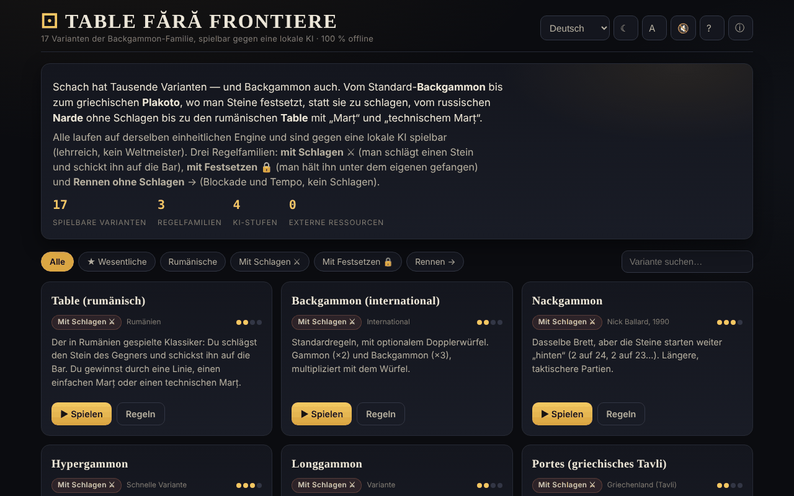

# Table fără frontiere

[English](README.md) · [Română](README.ro.md) · [Français](README.fr.md) · [Italiano](README.it.md) · [Español](README.es.md) · [Português](README.pt.md) · **Deutsch** · [Magyar](README.hu.md)

**Version:** 1.2.2 · **Zuletzt aktualisiert:** 2026-10-22

Oberflächensprachen: **Română, English, Français, Italiano, Español, Português (PT), Deutsch, Magyar**

17 Backgammon-Varianten, spielbar gegen eine lokale KI, in einer einzigen HTML-Datei.

**Online:** https://chiuta.github.io/Table-fara-frontiere/

## Was es ist

Ein spielbarer Atlas der „Tavla“-Spielfamilie: westliches Backgammon, griechisches Tavli (Portes, Plakoto, Fevga), türkisches Tavla, bulgarisches Tapa, russisches Narde, Gul Bara sowie rumänische Varianten mit marț und technischem marț. Alle laufen auf derselben Spiel-Engine, mit drei Regelfamilien: mit Schlagen ⚔, mit Fesseln 🔒 und Rennen ohne Schlagen →. Der Gegner ist eine lokale KI mit didaktischer Rolle, keine Turnier-Engine.

## Funktionen

- 17 Varianten, darunter: Table (rumänisch), Backgammon (international), Nackgammon, Hypergammon, Longgammon, Portes, Tavla, Acey-Deucey, Russisches Backgammon, Plakoto, Tapa, Moultezim / Mahbusa, Fevga, Narde / Lange Tavla, Gul Bara, Table pe duse (rumänisch, lang), Table de pierdut (Misère).
- Filter im Atlas: Alle, ★ Wesentliche, Rumänische, Mit Schlagen, Mit Fesseln, Rennen.
- KI mit vier Stufen: Anfänger, Mittel, Fortgeschritten, Experte (Bewertungsfunktion, auf den höheren Stufen zusätzlich eine Expectimax-Suche mit 1 Ply, laut Beschreibung in der App).
- Doppelungswürfel (optional, mit Verdopplungsvorschlag der KI), Punktestand pro Partie, Berechnung des marț für die rumänischen Varianten.
- **Führung im Spiel:** Eine Hinweiszeile unter „Du bist dran“ sagt, was als Nächstes kommt (würfeln, Stein wählen, Feld wählen, Zug beenden). **⌨ Mögliche Züge** (Dropdown-Liste) zeigt die regelkonformen Züge als Schaltflächen („Würfel 2: von 13 → 11 · schlägt“), sodass sich das Brett auch per Tastatur oder mit einem Screenreader spielen lässt.
- Schaltflächen: **Würfeln**, **↶ Zurück**, **Tipp**, **✓ Zug beenden**, **Neues Spiel**, **Regeln**.
- Design (☾; beim ersten Öffnen folgt es der Systemeinstellung), Textgröße (A), Ton (🔇), Hilfe (?) und „Über diesen Atlas“ (ⓘ).
- Regelannäherungen sind auf der Karte der Variante mit „⚠ Annäherung“ gekennzeichnet.

## Anleitung

1. Wähle eine Variante im Atlas (oder filtere nach Familie) und drücke **▶ Diese Variante spielen**.
2. Du spielst die weißen Steine (●), die KI die schwarzen (○). Drücke **Würfeln**; bei einem Pasch hast du vier Züge.
3. Tippe einen eigenen Stein an, dann das hervorgehobene Zielfeld; um einen Stein abzutragen, tippe auf den Bereich „Abgetragen“.
4. **↶ Zurück** macht den letzten Zug des Zuges rückgängig; **✓ Zug beenden** beendet den Zug.
5. Unter „Einstellungen“ wählst du die KI-Stufe und, wenn du möchtest, den Doppelungswürfel.
6. Tastenkürzel: **R** würfelt, **U** zurück, **Enter** beendet den Zug, **H** Tipp, **N** neues Spiel, **T** Design, **A** Text, **Esc** zurück / schließen.
7. **← Atlas** bringt dich zurück zur Liste der Varianten.

## Datenschutz und Netzwerk

- **Lokaler Speicher (localStorage):** ein einziger Schlüssel, `tff`, mit deinen Einstellungen: Design, Textgröße, Ton, KI-Stufe, Option des Doppelungswürfels und Anzeige der Feldnummern.
- **Netzwerk:** Die App stellt keine Netzwerkanfragen und lädt keine externen Ressourcen. Die Buy-Me-a-Coffee-Links öffnen sich nur per Klick. Keine Telemetrie.

## Lokal / offline ausführen

Lade `index.html` herunter und öffne sie in einem Browser; sie funktioniert ohne Internet.

## Lizenz

MIT — siehe die Datei `LICENSE`. Der Kopf von `index.html` und der Text der Oberfläche nennen dieselbe Lizenz (ein früherer Hinweis „CC-BY-SA 4.0“ in der Oberfläche wurde beim Audit, 2026-10-11, entfernt, um den Widerspruch zu beseitigen).

## Marken

Spielnamen sind Handelsnamen ihrer Inhaber und werden beschreibend verwendet; das Projekt ist nicht mit ihnen verbunden.

## Audit

Audit: 2026-10-10 — geprüft mit Playwright und axe-core (WCAG 2.1 AA, beide Designs); im Code geprüft: kein `fetch`/CDN, strikte CSP (`default-src 'self'`, Skript per Hash seit Runde 6). Behoben: Kontrast beim aktiven Filter im hellen Design, fokussierbare dekorative Checkbox.

## Verlauf / Changelog

- 1.2.2 — 2026-10-22: fff-kit 1.1.2: PBKDF2 mit 600.000 Iterationen, Schutz vor Clickjacking
- 1.2.1 — 2026-10-22: Lesbarkeit auf dem Handy (Text ≥ 12 px, größere Fußzeilen-Links) und Hinweis in der Fußzeile, dass die Würfel Web Crypto nutzen (crypto.getRandomValues).

- 1.1.0 — 2026-10-14: Datensicherung und Datenkennzeichnung (fff-kit).

- 1.0.0 — 2026-10-12: Die Version und das Datum der letzten Aktualisierung werden in der App angezeigt (erste nummerierte Version; in der Fußzeile).

Runde 7:
- **Feldnummern auf dem Brett:** Die 24 Felder sind am Brettrand nummeriert, mit denselben Nummern wie in der Liste „⌨ Mögliche Züge“ („Würfel 6: von 13 → 7“) — zuvor verwendete die Liste Nummern, die nirgends auf dem Brett erschienen. Sie lassen sich unter „Einstellungen → Feldnummern“ ausblenden (die Einstellung wird im Schlüssel `tff` gespeichert). CSP-Hash neu berechnet; axe-core = 0 Verstöße bei 1280 und 360 px.

Runde 6:
- **Korrektur:** Wenn du nach dem Startwurf begannst, blieb das Brett blockiert (die Hervorhebungen erschienen nicht und Klicks wurden ignoriert); jetzt kannst du sofort ziehen.
- Führung im Spiel (Hinweiszeile) und Liste „⌨ Mögliche Züge“ für Tastatur/Screenreader.
- Das Start-Design folgt `prefers-color-scheme`; Kontrast der aktiven Schaltfläche „KI-Stufe“ im hellen Design korrigiert; die Überschriften „Einstellungen“ / „Regeln in Kürze“ sind h3 (richtige Reihenfolge).
- CSP: Das Skript wird jetzt per Hash erlaubt, ohne `'unsafe-inline'` für Skripte (die App hat keine Inline-Handler). axe-core = 0 Verstöße bei 1280 und 360 px, in beiden Designs, auch im Spiel.

Runde 5:
- Nach dem Würfeln behält die Hauptschaltfläche nicht mehr den Text „Würfeln“: Sie zeigt „Gewürfelt“ (oder „KI ist dran“), solange sie deaktiviert ist; bei dir wechselt sie zurück zu „Würfeln“.
- Barrierefreiheit: Die Titel der Atlas-Karten sind h2 (richtige Reihenfolge unter h1), der Unterstützungsblock ist eine `complementary`-Landmarke; axe-core = 0 Verstöße bei 1280 und 360 px.

## Autor

Alexio — Alexandru-Ionuț Chiuță, Centrul StrING (wie in der App angegeben). Kontakt: alexio@trom.tf

## Zusammenfassung
Table fără frontiere ist ein Ein-Datei-Atlas mit 17 Spielen der Backgammon-Familie (westliches Backgammon, griechisches Tavli, türkisches Tavla, Narde, rumänische Table-Varianten und mehr), spielbar gegen eine lokale, didaktische KI mit vier Schwierigkeitsstufen auf einer einheitlichen Regel-Engine. Tastenkürzel sind vorhanden; nur Einstellungen werden in localStorage gespeichert, und es werden keine Netzwerkanfragen gestellt. Oberfläche auf Rumänisch. Lizenz MIT (siehe LICENSE).
