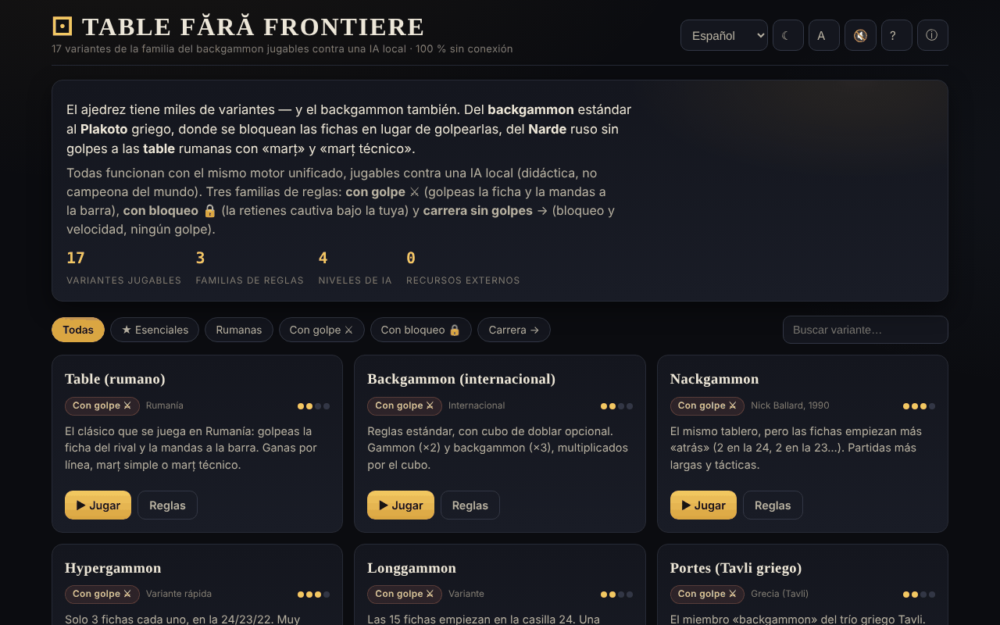

# Table fără frontiere

[English](README.md) · [Română](README.ro.md) · [Français](README.fr.md) · [Italiano](README.it.md) · **Español** · [Português](README.pt.md) · [Deutsch](README.de.md) · [Magyar](README.hu.md)

**Versión:** 1.2.4 · **Última actualización:** 2026-10-23

Idiomas de la interfaz: **Română, English, Français, Italiano, Español, Português (PT), Deutsch, Magyar**

17 variantes de la familia del backgammon jugables contra una IA local, en un único archivo HTML.

**En línea:** https://chiuta.github.io/Table-fara-frontiere/

## Qué es

Un atlas jugable de la familia de juegos de «tablas»: backgammon occidental, Tavli griego (Portes, Plakoto, Fevga), Tavla turca, Tapa búlgara, Narde ruso, Gul Bara y variantes rumanas con marț y marț técnico. Todas funcionan con el mismo motor de juego, con tres familias de reglas: con golpe ⚔, con bloqueo 🔒 y carrera sin golpe →. El oponente es una IA local de carácter didáctico, no un motor de torneo.

## Funciones

- 17 variantes, entre ellas: Table (rumano), Backgammon (internacional), Nackgammon, Hypergammon, Longgammon, Portes, Tavla, Acey-Deucey, Backgammon ruso, Plakoto, Tapa, Moultezim / Mahbusa, Fevga, Narde / Tablas largas, Gul Bara, Table pe duse (rumanas, largas), Table de pierdut (Misère).
- Filtros del atlas: Todas, ★ Esenciales, Rumanas, Con golpe, Con bloqueo, Carrera.
- IA con cuatro niveles: Principiante, Medio, Avanzado, Experto (función de evaluación, más una búsqueda expectimax de 1 ply en los niveles superiores, según la descripción de la aplicación).
- Dado de doblaje (opcional, con propuesta de doblaje por parte de la IA), puntuación por partida, cálculo del marț para las variantes rumanas.
- **Guía durante el juego:** una línea de indicaciones bajo «Tu turno» dice lo que sigue (tirar, elegir la ficha, elegir la casilla, terminar el turno). **⌨ Movimientos posibles** (lista desplegable) muestra los movimientos legales como botones («Dado 2: de 13 → 11 · golpea»), de modo que el tablero también se puede jugar con el teclado o con un lector de pantalla.
- Botones: **Tirar los dados**, **↶ Atrás**, **Pista**, **✓ Terminar el turno**, **Partida nueva**, **Reglas**.
- Tema (☾; en la primera apertura sigue la preferencia del sistema), tamaño del texto (A), sonido (🔇), ayuda (?) y «Acerca de este atlas» (ⓘ).
- Las aproximaciones de las reglas se marcan en la ficha de la variante con «⚠ aproximación».

## Manual de uso

1. Elige una variante del atlas (o filtra por familia) y pulsa **▶ Jugar esta variante**.
2. Tú juegas con las fichas blancas (●), la IA con las negras (○). Pulsa **Tirar los dados**; con un doble tienes cuatro movimientos.
3. Toca una ficha propia y luego la casilla de destino resaltada; para sacar una ficha, toca la zona «Retiradas».
4. **↶ Atrás** deshace el último movimiento del turno; **✓ Terminar el turno** da por terminado el turno.
5. En «Ajustes» eliges el nivel de la IA y, si quieres, el dado de doblaje.
6. Atajos de teclado: **R** tira los dados, **U** atrás, **Intro** termina el turno, **H** pista, **N** partida nueva, **T** tema, **A** texto, **Esc** atrás / cerrar.
7. **← Atlas** te devuelve a la lista de variantes.

## Privacidad y red

- **Almacenamiento local (localStorage):** una sola clave, `tff`, con tus preferencias: tema, tamaño del texto, sonido, nivel de la IA, opción del dado de doblaje y visualización de los números de casilla.
- **Red:** la aplicación no hace solicitudes de red y no carga recursos externos. Los enlaces de Buy Me a Coffee se abren solo al hacer clic. Sin telemetría.

## Ejecución local / sin conexión

Descarga `index.html` y ábrelo en un navegador; funciona sin Internet.

## Licencia

MIT — véase el archivo `LICENSE`. La cabecera de `index.html` y el texto de la interfaz indican la misma licencia (una mención anterior a «CC-BY-SA 4.0» en la interfaz se eliminó en la auditoría, 2026-10-11, para suprimir la contradicción).

## Marcas

Los nombres de los juegos son denominaciones comerciales de sus titulares, usadas de forma descriptiva; el proyecto no está afiliado a ellos.

## Auditoría

Auditoría: 2026-10-10 — verificado con Playwright y axe-core (WCAG 2.1 AA, ambos temas); verificado en el código: sin `fetch`/CDN, CSP estricta (`default-src 'self'`, script por hash desde la ronda 6). Corregidos: contraste en el filtro activo del tema claro, casilla decorativa que podía recibir el foco.

## Historial / Changelog

### 1.2.3 — 2026-10-22

fff-kit 1.1.4: objetivos táctiles y tamaño mínimo de texto.

- 1.2.2 — 2026-10-22: fff-kit 1.1.2: PBKDF2 con 600.000 iteraciones, protección anti-clickjacking
- 1.2.1 — 2026-10-22: Legibilidad en móvil (texto ≥ 12 px, enlaces del pie más grandes) y nota en el pie de que los dados usan Web Crypto (crypto.getRandomValues).

- 1.1.0 — 2026-10-14: Copia de seguridad y etiquetado de datos (fff-kit).

- 1.0.0 — 2026-10-12: la versión y la fecha de la última actualización se muestran en la aplicación (primera versión numerada; en el pie de página).

Ronda 7:
- **Números de casilla en el tablero:** las 24 casillas están numeradas en el borde del tablero, con los mismos números que en la lista «⌨ Movimientos posibles» («Dado 6: de 13 → 7») — antes la lista usaba números que no aparecían en ninguna parte del tablero. Se pueden ocultar desde «Ajustes → Números de casilla» (la preferencia se guarda en la clave `tff`). Hash CSP recalculado; axe-core = 0 infracciones a 1280 y 360 px.

Ronda 6:
- **Corrección:** cuando empezabas tú tras el dado de salida, el tablero se quedaba bloqueado (no aparecían los resaltados y se ignoraban los clics); ahora puedes mover enseguida.
- Guía durante el juego (línea de indicaciones) y lista «⌨ Movimientos posibles» para teclado/lectores de pantalla.
- El tema inicial sigue `prefers-color-scheme`; contraste corregido en el botón activo «Nivel IA» en el tema claro; los títulos «Ajustes» / «Reglas en breve» son h3 (orden correcto).
- CSP: el script ahora se permite por hash, sin `'unsafe-inline'` para scripts (la aplicación no tiene manejadores en línea). axe-core = 0 infracciones a 1280 y 360 px, en ambos temas, también durante el juego.

Ronda 5:
- Tras tirar los dados, el botón principal ya no conserva el texto «Tirar los dados»: muestra «Dados tirados» (o «Turno de la IA») mientras está desactivado; vuelve a «Tirar los dados» en tu turno.
- Accesibilidad: los títulos de las fichas del atlas son h2 (orden correcto bajo h1), el bloque de apoyo es un punto de referencia `complementary`; axe-core = 0 infracciones a 1280 y 360 px.

## Autor

Alexio — Alexandru-Ionuț Chiuță, Centrul StrING (según se menciona en la aplicación). Contacto: alexio@trom.tf

## Resumen

Table fără frontiere es un atlas en un solo archivo de 17 juegos de la familia del backgammon (backgammon occidental, Tavli griego, Tavla turca, Narde, variantes rumanas de tablas y más) jugables contra una IA local de carácter didáctico con cuatro niveles de dificultad, sobre un motor de reglas unificado. Se incluyen atajos de teclado; solo se guardan las preferencias en localStorage y no se hace ninguna solicitud de red. Interfaz en rumano. Licencia MIT (véase LICENSE).
