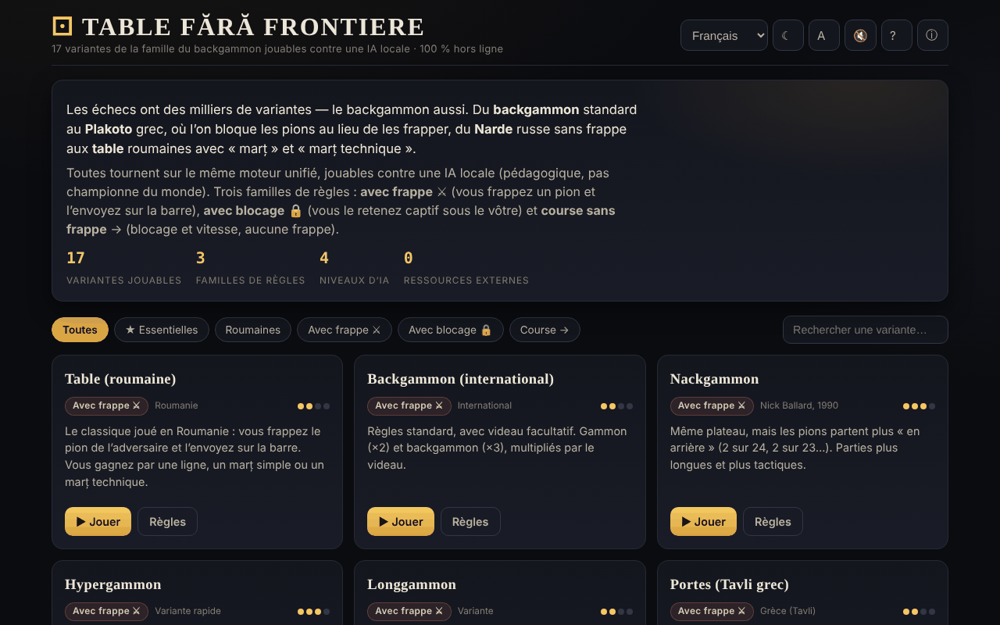

# Table fără frontiere

[English](README.md) · [Română](README.ro.md) · **Français** · [Italiano](README.it.md) · [Español](README.es.md) · [Português](README.pt.md) · [Deutsch](README.de.md) · [Magyar](README.hu.md)

**Version :** 1.2.2 · **Dernière mise à jour :** 2026-10-22

Langues de l'interface : **Română, English, Français, Italiano, Español, Português (PT), Deutsch, Magyar**

17 variantes de jeux de la famille du backgammon jouables contre une IA locale, dans un seul fichier HTML.

**En ligne :** https://chiuta.github.io/Table-fara-frontiere/

## Ce que c'est

Un atlas jouable de la famille des jeux de « tables » : backgammon occidental, Tavli grec (Portes, Plakoto, Fevga), Tavla turque, Tapa bulgare, Narde russe, Gul Bara, et des variantes roumaines avec marț et marț technique. Tous fonctionnent sur le même moteur de jeu, avec trois familles de règles : avec prise ⚔, avec blocage 🔒 et course sans prise →. L'adversaire est une IA locale à vocation pédagogique, non un moteur de tournoi.

## Fonctions

- 17 variantes, dont : Table (roumain), Backgammon (international), Nackgammon, Hypergammon, Longgammon, Portes, Tavla, Acey-Deucey, Backgammon russe, Plakoto, Tapa, Moultezim / Mahbusa, Fevga, Narde / Tables longues, Gul Bara, Table pe duse (roumaines, longues), Table de pierdut (Misère).
- Filtres de l'atlas : Toutes, ★ Essentielles, Roumaines, Avec prise, Avec blocage, Course.
- IA à quatre niveaux : Débutant, Moyen, Avancé, Expert (fonction d'évaluation, plus une recherche expectimax à 1 coup aux niveaux supérieurs, d'après la description de l'application).
- Videau (optionnel, avec proposition de doublement de la part de l'IA), score par partie, calcul du marț pour les variantes roumaines.
- **Guidage en cours de partie :** une ligne d'indications sous « À toi de jouer » dit ce qui suit (lancer, choisir le pion, choisir la case, terminer le tour). **⌨ Coups possibles** (liste déroulante) affiche les coups légaux sous forme de boutons (« Dé 2 : de 13 → 11 · prend »), de sorte que le tablier peut aussi se jouer au clavier ou avec un lecteur d'écran.
- Boutons : **Lancer les dés**, **↶ Retour**, **Suggestion**, **✓ Terminer le tour**, **Nouvelle partie**, **Règles**.
- Thème (☾ ; à la première ouverture il suit la préférence du système), taille du texte (A), son (🔇), aide (?) et « À propos de cet atlas » (ⓘ).
- Les approximations des règles sont signalées sur la fiche de la variante par « ⚠ approximation ».

## Mode d'emploi

1. Choisissez une variante dans l'atlas (ou filtrez par famille) et appuyez sur **▶ Jouer cette variante**.
2. Vous jouez les pions blancs (●), l'IA les noirs (○). Appuyez sur **Lancer les dés** ; avec un double, vous avez quatre coups.
3. Touchez l'un de vos pions, puis la case cible en surbrillance ; pour sortir un pion, touchez la zone « Sortis ».
4. **↶ Retour** annule le dernier coup du tour ; **✓ Terminer le tour** met fin au tour.
5. Dans « Réglages », vous choisissez le niveau de l'IA et, si vous le souhaitez, le videau.
6. Raccourcis clavier : **R** lance les dés, **U** retour, **Entrée** termine le tour, **H** suggestion, **N** nouvelle partie, **T** thème, **A** texte, **Échap** retour / fermer.
7. **← Atlas** vous ramène à la liste des variantes.

## Confidentialité et réseau

- **Stockage local (localStorage) :** une seule clé, `tff`, avec vos préférences : thème, taille du texte, son, niveau de l'IA, option du videau et affichage des numéros de cases.
- **Réseau :** l'application n'envoie aucune requête réseau et ne charge aucune ressource externe. Les liens Buy Me a Coffee ne s'ouvrent qu'au clic. Aucune télémétrie.

## Exécution locale / hors ligne

Téléchargez `index.html` et ouvrez-le dans un navigateur ; il fonctionne sans Internet.

## Licence

MIT — voir le fichier `LICENSE`. L'en-tête de `index.html` et le texte de l'interface indiquent la même licence (une ancienne mention « CC-BY-SA 4.0 » dans l'interface a été supprimée lors de l'audit, le 2026-10-11, pour éliminer la contradiction).

## Marques

Les noms de jeux sont des appellations commerciales de leurs titulaires, utilisées à titre descriptif ; le projet n'est pas affilié à ceux-ci.

## Audit

Audit : 2026-10-10 — vérifié avec Playwright et axe-core (WCAG 2.1 AA, les deux thèmes) ; vérifié dans le code : pas de `fetch`/CDN, CSP stricte (`default-src 'self'`, script par hachage depuis le tour 6). Corrigés : contraste sur le filtre actif dans le thème clair, case à cocher décorative pouvant recevoir le focus.

## Historique / Changelog

- 1.2.2 — 2026-10-22 : fff-kit 1.1.2 : PBKDF2 à 600 000 itérations, protection anti-clickjacking
- 1.2.1 — 2026-10-22 : Lisibilité sur mobile (texte ≥ 12 px, liens du pied de page plus grands) et mention dans le pied de page que les dés utilisent Web Crypto (crypto.getRandomValues).

- 1.1.0 — 2026-10-14 : Sauvegarde et étiquetage des données (fff-kit).

- 1.0.0 — 2026-10-12 : la version et la date de la dernière mise à jour sont affichées dans l'application (première version numérotée ; dans le pied de page).

Tour 7 :
- **Numéros de cases sur le tablier :** les 24 cases sont numérotées sur le bord du tablier, avec les mêmes numéros que dans la liste « ⌨ Coups possibles » (« Dé 6 : de 13 → 7 ») — auparavant la liste utilisait des numéros qui n'apparaissaient nulle part sur le tablier. Ils peuvent être masqués via « Réglages → Numéros de cases » (la préférence est conservée dans la clé `tff`). Hachage CSP recalculé ; axe-core = 0 violation à 1280 et 360 px.

Tour 6 :
- **Correction :** quand vous commenciez après le dé d'ouverture, le tablier restait bloqué (les surbrillances n'apparaissaient pas et les clics étaient ignorés) ; vous pouvez maintenant jouer immédiatement.
- Guidage en cours de partie (ligne d'indications) et liste « ⌨ Coups possibles » pour le clavier / les lecteurs d'écran.
- Le thème initial suit `prefers-color-scheme` ; contraste corrigé sur le bouton actif « Niveau de l'IA » dans le thème clair ; les titres « Réglages » / « Règles en bref » sont des h3 (ordre correct).
- CSP : le script est désormais autorisé par hachage, sans `'unsafe-inline'` pour les scripts (l'application n'a pas de gestionnaires en ligne). axe-core = 0 violation à 1280 et 360 px, dans les deux thèmes, y compris en partie.

Tour 5 :
- Après le lancer des dés, le bouton principal ne garde plus le texte « Lancer les dés » : il affiche « Dés lancés » (ou « Tour de l'IA ») tant qu'il est désactivé ; il redevient « Lancer les dés » à votre tour.
- Accessibilité : les titres des fiches de l'atlas sont des h2 (ordre correct sous h1), le bloc de soutien est un repère `complementary` ; axe-core = 0 violation à 1280 et 360 px.

## Auteur

Alexio — Alexandru-Ionuț Chiuță, Centrul StrING (comme mentionné dans l'application). Contact : alexio@trom.tf

## Résumé
Table fără frontiere est un atlas en un seul fichier de 17 jeux de la famille du backgammon (backgammon occidental, Tavli grec, Tavla turque, Narde, variantes roumaines de tables et autres), jouables contre une IA locale à vocation pédagogique à quatre niveaux de difficulté, sur un moteur de règles unifié. Des raccourcis clavier sont fournis ; seules les préférences sont stockées dans localStorage et aucune requête réseau n'est effectuée. Interface en roumain. Sous licence MIT (voir LICENSE).
