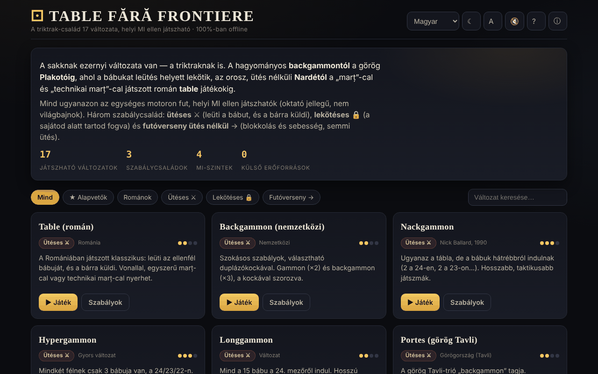

# Table fără frontiere

[English](README.md) · [Română](README.ro.md) · [Français](README.fr.md) · [Italiano](README.it.md) · [Español](README.es.md) · [Português](README.pt.md) · [Deutsch](README.de.md) · **Magyar**

**Verzió:** 2.0.0 · **Utolsó frissítés:** 2026-10-26

A felület nyelvei: **Română, English, Français, Italiano, Español, Português (PT), Deutsch, Magyar**

17 backgammon-családba tartozó változat, helyi MI ellen játszható, egyetlen HTML-fájlban.

**Élő:** https://chiuta.github.io/Table-fara-frontiere/

## Mi ez

A „tábla” (tavla) játékcsalád játszható atlasza: nyugati backgammon, görög Tavli (Portes, Plakoto, Fevga), török Tavla, bolgár Tapa, orosz Narde, Gul Bara, valamint román változatok marț-cal és technikai marț-cal. Mindegyik ugyanazon a játékmotoron fut, három szabálycsaláddal: ütéssel ⚔, megkötéssel 🔒 és ütés nélküli futammal →. Az ellenfél egy oktatási szerepű helyi MI, nem versenymotor.

## Funkciók

- 17 változat, többek között: Table (román), Backgammon (nemzetközi), Nackgammon, Hypergammon, Longgammon, Portes, Tavla, Acey-Deucey, Orosz backgammon, Plakoto, Tapa, Moultezim / Mahbusa, Fevga, Narde / Hosszú táblák, Gul Bara, Table pe duse (román, hosszú), Table de pierdut (Misère).
- Szűrők az atlaszban: Mind, ★ Alapvetők, Románok, Ütéssel, Megkötéssel, Futam.
- Négy szintű MI: Kezdő, Közepes, Haladó, Szakértő (értékelőfüggvény, a magasabb szinteken ezenfelül 1 lépéses expectimax-keresés, az alkalmazás leírása szerint).
- Duplázókocka (opcionális, az MI duplázási javaslatával), pontszám játszmánként, a marț számítása a román változatokhoz.
- **Útmutatás játék közben:** a „Te jössz” alatti tippsor megmondja, mi következik (dobás, bábu kiválasztása, mező kiválasztása, a kör befejezése). A **⌨ Lehetséges lépések** (legördülő lista) a szabályos lépéseket gombokként mutatja („2-es kocka: 13-ról → 11-re · ütés”), így a tábla billentyűzettel vagy képernyőolvasóval is játszható.
- Gombok: **Dobás**, **↶ Vissza**, **Tipp**, **✓ Kör befejezése**, **Új játék**, **Szabályok**.
- Téma (☾; első megnyitáskor a rendszer beállítását követi), szövegméret (A), hang (🔇), súgó (?) és „Az atlaszról” (ⓘ).
- A szabályközelítések a változat kártyáján „⚠ közelítés” jelöléssel szerepelnek.

## Használati útmutató

1. Válassz változatot az atlaszból (vagy szűrj család szerint), és nyomd meg a **▶ Ezt a változatot játszom** gombot.
2. Te a fehér bábukkal (●) játszol, az MI a feketékkel (○). Nyomd meg a **Dobás** gombot; dupla esetén négy lépésed van.
3. Érints meg egy saját bábut, majd a kiemelt célmezőt; bábu kivételéhez érintsd meg a „Kivett” területet.
4. A **↶ Vissza** visszavonja a kör utolsó lépését; a **✓ Kör befejezése** lezárja a kört.
5. A „Beállítások”-ban kiválasztod az MI szintjét és, ha akarod, a duplázókockát.
6. Billentyűparancsok: **R** dob, **U** vissza, **Enter** befejezi a kört, **H** tipp, **N** új játék, **T** téma, **A** szöveg, **Esc** vissza / bezár.
7. A **← Atlasz** visszavisz a változatok listájához.

## Adatvédelem és hálózat

- **Helyi tárhely (localStorage):** egyetlen kulcs, `table-fara-frontiere.prefs`, a beállításaiddal: téma, szövegméret, hang, MI-szint, a duplázókocka opciója és a mezőszámok megjelenítése.
- **Hálózat:** az alkalmazás nem küld hálózati kéréseket, és nem tölt be külső erőforrásokat. A Buy Me a Coffee hivatkozások csak kattintásra nyílnak meg. Nincs telemetria.

## Helyi / offline futtatás

Töltsd le az `index.html` fájlt, és nyisd meg böngészőben; internet nélkül működik.

## Licenc

MIT — lásd a `LICENSE` fájlt. Az `index.html` fejléce és a felület szövege ugyanazt a licencet jelzi (a felületen korábban szereplő „CC-BY-SA 4.0” említést az auditkor, 2026-10-11-én eltávolították az ellentmondás megszüntetése érdekében).

## Védjegyek

A játékok nevei a jogtulajdonosaik kereskedelmi elnevezései, leíró jelleggel használva; a projekt nem áll kapcsolatban velük.

## Audit

Audit: 2026-10-10 — Playwrighttal és axe-core-ral ellenőrizve (WCAG 2.1 AA, mindkét téma); a kódban ellenőrizve: nincs `fetch`/CDN, szigorú CSP (`default-src 'self'`, a szkript hash alapján engedélyezett a 6. kör óta). Javítva: kontraszt az aktív szűrőn a világos témában, fókuszálható dekoratív jelölőnégyzet.

## Előzmények / Changelog

### 1.2.6 — 2026-10-23
- Beállítások: az ismeretlen `localStorage` értékek (téma, méret, nehézség) figyelmen kívül maradnak; korábban egy ismeretlen nehézség „Haladó”-ként játszott, miközben egyik gomb sem volt kijelölve.

### 1.2.5 — 2026-10-23

- A helyi tárhely kulcsai mostantól a `table-fara-frontiere.` előtagot használják (`FFF.store.migrate` induláskor, bármilyen olvasás előtt): a meglévő adatok automatikusan megmaradnak, a régi `.fff.json` mentések továbbra is importálhatók.

### 1.2.3 — 2026-10-22

fff-kit 1.1.4: érintési célok és minimális szövegméret.

- 1.2.2 — 2026-10-22: fff-kit 1.1.2: PBKDF2 600 000 iterációval, clickjacking elleni védelem
- 1.2.1 — 2026-10-22: Mobilon jobb olvashatóság (szöveg ≥ 12 px, nagyobb lábléc-hivatkozások), és a láblécben jelezve, hogy a kockák a Web Crypto-t használják (crypto.getRandomValues).

- 1.1.0 — 2026-10-14: Biztonsági mentés és adatcímkézés (fff-kit).

- 1.0.0 — 2026-10-12: a verzió és az utolsó frissítés dátuma megjelenik az alkalmazásban (első számozott verzió; a láblécben).

7. kör:
- **Mezőszámok a táblán:** a 24 mező a tábla szélén számozva van, ugyanazokkal a számokkal, mint a „⌨ Lehetséges lépések” listában („6-os kocka: 13-ról → 7-re”) — korábban a lista olyan számokat használt, amelyek sehol sem szerepeltek a táblán. A „Beállítások → Mezőszámok” alatt elrejthetők (a beállítás a `table-fara-frontiere.prefs` kulcsban marad). A CSP-hash újraszámolva; axe-core = 0 hiba 1280 és 360 px szélességnél.

6. kör:
- **Javítás:** ha a nyitódobás után te kezdtél, a tábla blokkolva maradt (a kiemelések nem jelentek meg, a kattintásokat figyelmen kívül hagyta); most azonnal léphetsz.
- Útmutatás játék közben (tippsor) és „⌨ Lehetséges lépések” lista billentyűzethez/képernyőolvasókhoz.
- A kezdeti téma a `prefers-color-scheme` értéket követi; javítva az aktív „MI-szint” gomb kontrasztja a világos témában; a „Beállítások” / „Szabályok röviden” címek h3 elemek (helyes sorrend).
- CSP: a szkript most hash alapján engedélyezett, `'unsafe-inline'` nélkül a szkriptekhez (az alkalmazásnak nincsenek inline eseménykezelői). axe-core = 0 hiba 1280 és 360 px szélességnél, mindkét témában, a játék közben is.

5. kör:
- A kockadobás után a főgomb már nem tartja meg a „Dobás” szöveget: letiltott állapotban „Eldobva” (vagy „Az MI köre”) látható; a te körödben visszaáll „Dobás”-ra.
- Akadálymentesség: az atlaszkártyák címei h2 elemek (helyes sorrend az h1 alatt), a támogatási blokk `complementary` tájékozódási pont; axe-core = 0 hiba 1280 és 360 px szélességnél.

## Szerző

Alexio — Alexandru-Ionuț Chiuță, Centrul StrING (az alkalmazásban említettek szerint). Kapcsolat: alexio@trom.tf

## Összefoglaló
A Table fără frontiere egyetlen fájlba zárt atlasz 17 backgammon-családba tartozó játékkal (nyugati backgammon, görög Tavli, török Tavla, Narde, román tábla-változatok és mások), amelyek egy helyi, oktatási célú, négy nehézségi szintű MI ellen játszhatók, egységes szabálymotoron. Billentyűparancsok állnak rendelkezésre; a localStorage csak a beállításokat tárolja, hálózati kérések nincsenek. A felület román nyelvű. MIT licenc (lásd LICENSE).
