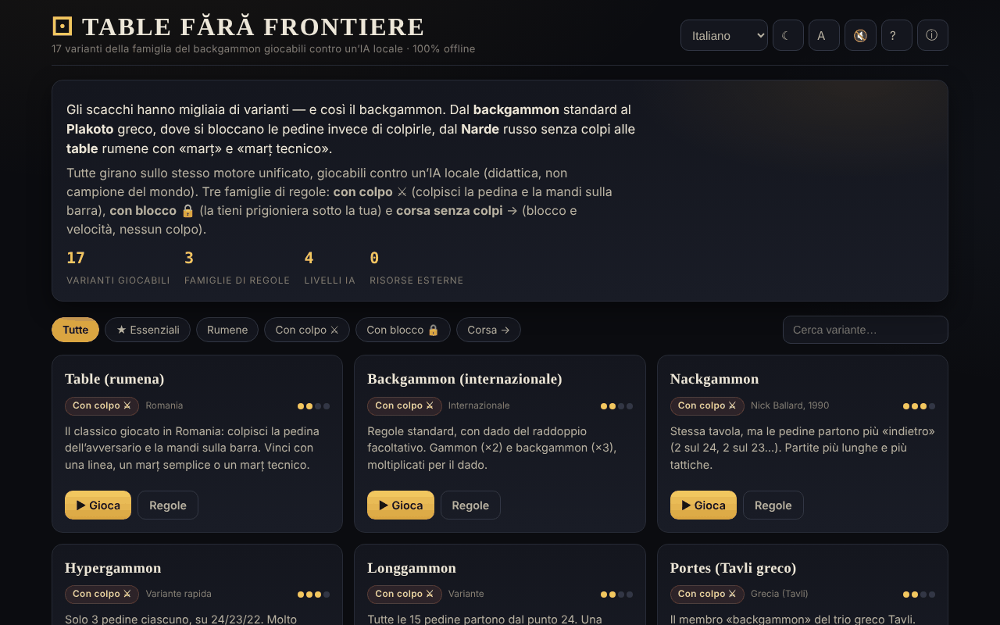

# Table fără frontiere

[English](README.md) · [Română](README.ro.md) · [Français](README.fr.md) · **Italiano** · [Español](README.es.md) · [Português](README.pt.md) · [Deutsch](README.de.md) · [Magyar](README.hu.md)

**Versione:** 1.2.1 · **Ultimo aggiornamento:** 2026-10-22

Lingue dell'interfaccia: **Română, English, Français, Italiano, Español, Português (PT), Deutsch, Magyar**

17 varianti della famiglia del backgammon giocabili contro un'IA locale, in un unico file HTML.

**Online:** https://chiuta.github.io/Table-fara-frontiere/

## Che cos'è

Un atlante giocabile della famiglia dei giochi di «tavola»: backgammon occidentale, Tavli greco (Portes, Plakoto, Fevga), Tavla turca, Tapa bulgara, Narde russo, Gul Bara e varianti rumene con marț e marț tecnico. Girano tutte sullo stesso motore di gioco, con tre famiglie di regole: con colpo ⚔, con blocco 🔒 e corsa senza colpo →. L'avversario è un'IA locale con funzione didattica, non un motore da torneo.

## Funzioni

- 17 varianti, tra cui: Table (rumeno), Backgammon (internazionale), Nackgammon, Hypergammon, Longgammon, Portes, Tavla, Acey-Deucey, Backgammon russo, Plakoto, Tapa, Moultezim / Mahbusa, Fevga, Narde / Tavole lunghe, Gul Bara, Table pe duse (rumene, lunghe), Table de pierdut (Misère).
- Filtri dell'atlante: Tutte, ★ Essenziali, Rumene, Con colpo, Con blocco, Corsa.
- IA a quattro livelli: Principiante, Medio, Avanzato, Esperto (funzione di valutazione, più una ricerca expectimax a 1 ply nei livelli superiori, secondo la descrizione nell'app).
- Dado del raddoppio (facoltativo, con proposta di raddoppio da parte dell'IA), punteggio per partita, calcolo del marț per le varianti rumene.
- **Guida durante il gioco:** una riga di indicazioni sotto «Tocca a te» dice cosa viene dopo (tira, scegli la pedina, scegli la casella, termina il turno). **⌨ Mosse possibili** (elenco a discesa) mostra le mosse legali come pulsanti («Dado 2: da 13 → 11 · colpisce»), quindi la tavola si può giocare anche da tastiera o con un lettore di schermo.
- Pulsanti: **Tira i dadi**, **↶ Indietro**, **Suggerimento**, **✓ Termina il turno**, **Nuova partita**, **Regole**.
- Tema (☾; alla prima apertura segue la preferenza del sistema), dimensione del testo (A), suono (🔇), aiuto (?) e «Informazioni su questo atlante» (ⓘ).
- Le approssimazioni delle regole sono segnalate sulla scheda della variante con «⚠ approssimazione».

## Guida all'uso

1. Scegli una variante dall'atlante (o filtra per famiglia) e premi **▶ Gioca questa variante**.
2. Tu giochi le pedine bianche (●), l'IA quelle nere (○). Premi **Tira i dadi**; con un doppio hai quattro mosse.
3. Tocca una tua pedina, poi la casella di destinazione evidenziata; per portare fuori una pedina, tocca l'area «Uscite».
4. **↶ Indietro** annulla l'ultima mossa del turno; **✓ Termina il turno** chiude il turno.
5. Da «Impostazioni» scegli il livello dell'IA e, se vuoi, il dado del raddoppio.
6. Scorciatoie da tastiera: **R** tira i dadi, **U** indietro, **Invio** termina il turno, **H** suggerimento, **N** nuova partita, **T** tema, **A** testo, **Esc** indietro / chiudi.
7. **← Atlante** ti riporta all'elenco delle varianti.

## Privacy e rete

- **Archiviazione locale (localStorage):** una sola chiave, `tff`, con le tue preferenze: tema, dimensione del testo, suono, livello dell'IA, opzione del dado del raddoppio e visualizzazione dei numeri delle caselle.
- **Rete:** l'app non effettua richieste di rete e non carica risorse esterne. I link Buy Me a Coffee si aprono solo al clic. Nessuna telemetria.

## Esecuzione locale / offline

Scarica `index.html` e aprilo in un browser; funziona senza Internet.

## Licenza

MIT — vedi il file `LICENSE`. L'intestazione di `index.html` e il testo dell'interfaccia indicano la stessa licenza (una precedente menzione «CC-BY-SA 4.0» nell'interfaccia è stata rimossa durante l'audit, 2026-10-11, per eliminare la contraddizione).

## Marchi

I nomi dei giochi sono denominazioni commerciali dei loro titolari, usate a scopo descrittivo; il progetto non è affiliato ad essi.

## Audit

Audit: 2026-10-10 — verificato con Playwright e axe-core (WCAG 2.1 AA, entrambi i temi); verificato nel codice: nessun `fetch`/CDN, CSP rigorosa (`default-src 'self'`, script tramite hash dal turno 6). Corretti: contrasto sul filtro attivo nel tema chiaro, checkbox decorativa che poteva ricevere il focus.

## Cronologia / Changelog

- 1.2.1 — 2026-10-22: Leggibilità su mobile (testo ≥ 12 px, link del piè di pagina più grandi) e nota nel piè di pagina che i dadi usano Web Crypto (crypto.getRandomValues).

- 1.1.0 — 2026-10-14: Copia di riserva ed etichettatura dei dati (fff-kit).

- 1.0.0 — 2026-10-12: la versione e la data dell'ultimo aggiornamento sono mostrate nell'app (prima versione numerata; nel piè di pagina).

Turno 7:
- **Numeri delle caselle sulla tavola:** le 24 caselle sono numerate sul bordo della tavola, con gli stessi numeri dell'elenco «⌨ Mosse possibili» («Dado 6: da 13 → 7») — prima l'elenco usava numeri che non comparivano da nessuna parte sulla tavola. Si possono nascondere da «Impostazioni → Numeri caselle» (la preferenza è conservata nella chiave `tff`). Hash CSP ricalcolato; axe-core = 0 violazioni a 1280 e 360 px.

Turno 6:
- **Correzione:** quando iniziavi tu dopo il dado di apertura, la tavola restava bloccata (le evidenziazioni non comparivano e i clic erano ignorati); ora puoi muovere subito.
- Guida durante il gioco (riga di indicazioni) ed elenco «⌨ Mosse possibili» per tastiera/lettori di schermo.
- Il tema iniziale segue `prefers-color-scheme`; contrasto corretto sul pulsante attivo «Livello IA» nel tema chiaro; i titoli «Impostazioni» / «Regole in breve» sono h3 (ordine corretto).
- CSP: lo script è ora consentito tramite hash, senza `'unsafe-inline'` per gli script (l'app non ha handler inline). axe-core = 0 violazioni a 1280 e 360 px, in entrambi i temi, anche durante il gioco.

Turno 5:
- Dopo il lancio dei dadi, il pulsante principale non conserva più il testo «Tira i dadi»: mostra «Dadi tirati» (oppure «Turno dell'IA») finché è disattivato; torna a «Tira i dadi» al tuo turno.
- Accessibilità: i titoli delle schede dell'atlante sono h2 (ordine corretto sotto h1), il blocco di sostegno è un punto di riferimento `complementary`; axe-core = 0 violazioni a 1280 e 360 px.

## Autore

Alexio — Alexandru-Ionuț Chiuță, Centrul StrING (come indicato nell'app). Contatto: alexio@trom.tf

## Riepilogo
Table fără frontiere è un atlante in un unico file di 17 giochi della famiglia del backgammon (backgammon occidentale, Tavli greco, Tavla turca, Narde, varianti rumene di tavola e altro) giocabili contro un'IA locale con funzione didattica a quattro livelli di difficoltà, su un unico motore di regole. Sono previste scorciatoie da tastiera; in localStorage sono memorizzate solo le preferenze e non viene effettuata alcuna richiesta di rete. Interfaccia in rumeno. Licenza MIT (vedi LICENSE).
