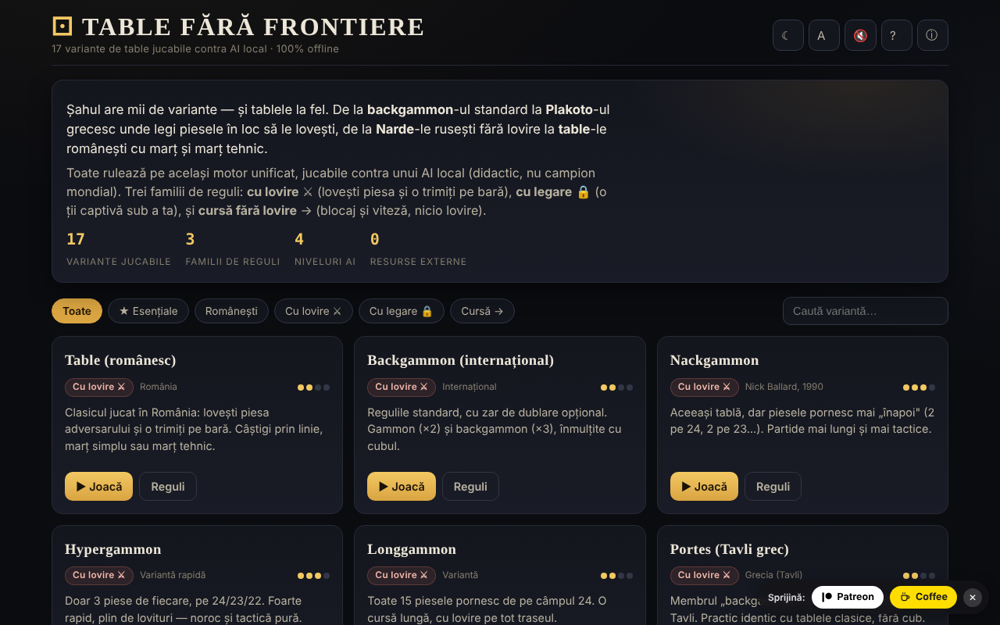

# Table fără frontiere

**Versiune:** 1.0.0 · **Ultima actualizare:** 12 octombrie 2026

17 variante de table jucabile contra unui AI local, într-un singur fișier HTML.

**Live:** https://chiuta.github.io/Table-fara-frontiere/

## Ce este

Un atlas jucabil al familiei de jocuri „table”: backgammon occidental, Tavli grecesc (Portes, Plakoto, Fevga), Tavla turcească, Tapa bulgărească, Narde rusești, Gul Bara și variante românești cu marț și marț tehnic. Toate rulează pe același motor de joc, cu trei familii de reguli: cu lovire ⚔, cu legare 🔒 și cursă fără lovire →. Adversarul este un AI local, cu rol didactic, nu un motor de turneu.

## Funcții

- 17 variante, între care: Table (românesc), Backgammon (internațional), Nackgammon, Hypergammon, Longgammon, Portes, Tavla, Acey-Deucey, Backgammon rusesc, Plakoto, Tapa, Moultezim / Mahbusa, Fevga, Narde / Table lungi, Gul Bara, Table pe duse (românești, lungi), Table de pierdut (Misère).
- Filtre în atlas: Toate, ★ Esențiale, Românești, Cu lovire, Cu legare, Cursă.
- AI cu patru niveluri: Începător, Mediu, Avansat, Expert (funcție de evaluare, plus căutare expectimax de 1 ply la nivelurile superioare, după descrierea din aplicație).
- Zar de dublare (opțional, cu propunere de dublare din partea AI-ului), scor pe partide, calcul de marț pentru variantele românești.
- **Ghidare în joc:** un rând de indicații sub „Rândul tău” spune ce urmează (arunci, alegi piesa, alegi câmpul, termini tura). **⌨ Mutări posibile** (listă derulantă) arată mutările legale ca butoane („Zar 2: de pe 13 → 11 · lovește”), deci tabla se poate juca și de la tastatură sau cu un cititor de ecran.
- Butoane: **Aruncă zarurile**, **↶ Înapoi**, **Sugestie**, **✓ Termină tura**, **Joc nou**, **Reguli**.
- Temă (☾; la prima deschidere urmează preferința sistemului), mărime text (A), sunet (🔇), ajutor (?) și „Despre acest atlas” (ⓘ).
- Aproximările de reguli sunt marcate pe cartonașul variantei cu „⚠ aproximare”.

## Manual de utilizare

1. Alege o variantă din atlas (sau filtrează după familie) și apasă **▶ Joacă această variantă**.
2. Joci cu piesele albe (●), AI-ul cu cele negre (○). Apasă **Aruncă zarurile**; la o dublă ai patru mutări.
3. Atinge o piesă proprie, apoi câmpul-țintă evidențiat; pentru a scoate o piesă, atinge zona „Scoase”.
4. **↶ Înapoi** anulează ultima mutare din tură; **✓ Termină tura** încheie tura.
5. Din „Reglaje” alegi nivelul AI și, dacă vrei, zarul de dublare.
6. Scurtături de tastatură: **R** aruncă zarurile, **U** înapoi, **Enter** termină tura, **H** sugestie, **N** joc nou, **T** temă, **A** text, **Esc** înapoi / închide.
7. **← Atlas** te întoarce la lista de variante.

## Confidențialitate și rețea

- **Stocare locală (localStorage):** o singură cheie, `tff`, cu preferințele tale: temă, mărime text, sunet, nivel AI, opțiunea zarului de dublare și afișarea numerelor de câmp.
- **Rețea:** aplicația nu face cereri de rețea și nu încarcă resurse externe. Linkurile Patreon și Buy Me a Coffee se deschid doar la clic. Fără telemetrie.

## Rulare locală / offline

Descarcă `index.html` și deschide-l în browser; funcționează fără internet.

## Licență

CC0 1.0 Universal (dedicare în domeniul public) — vezi fișierul `LICENSE`. Antetul din `index.html` și textul din interfață indică aceeași licență (o mențiune anterioară „CC-BY-SA 4.0” din interfață a fost eliminată la audit, 2026-10-11, pentru a elimina contradicția).

## Mărci

Numele de jocuri sunt denumiri comerciale ale deținătorilor lor, folosite descriptiv; proiectul nu este afiliat cu aceștia.

## Audit

Audit: 2026-10-10 — verificat cu Playwright și axe-core (WCAG 2.1 AA, ambele teme); verificat în cod: fără `fetch`/CDN, CSP strict (`default-src 'self'`, script pe hash din runda 6). Corectate: contrast pe filtrul activ în tema luminoasă, checkbox decorativ focalizabil.

## Istoric / Changelog

- 1.0.0 — 2026-10-12: versiunea și data ultimei actualizări sunt afișate în aplicație (prima versiune numerotată; în subsol).

Runda 7:
- **Numere de câmp pe tablă:** cele 24 de câmpuri sunt numerotate pe marginea tablei, cu aceleași numere ca în lista „⌨ Mutări posibile” („Zar 6: de pe 13 → 7”) — înainte lista folosea numere care nu apăreau nicăieri pe tablă. Se pot ascunde din „Reglaje → Numere câmpuri” (preferința se păstrează în cheia `tff`). Hash-ul CSP recalculat; axe-core = 0 violări la 1280 și 360 px.

Runda 6:
- **Corecție:** când începeai tu după zarul de start, tabla rămânea blocată (nu apăreau evidențierile și clicurile erau ignorate); acum poți muta imediat.
- Ghidare în joc (rând de indicații) și listă „⌨ Mutări posibile” pentru tastatură/cititoare de ecran.
- Tema inițială urmează `prefers-color-scheme`; contrast corectat la butonul activ „Nivel AI” în tema luminoasă; titlurile „Reglaje” / „Reguli pe scurt” sunt h3 (ordine corectă).
- CSP: scriptul este acum permis prin hash, fără `'unsafe-inline'` pentru scripturi (aplicația nu are handlere inline). axe-core = 0 violări la 1280 și 360 px, în ambele teme, inclusiv în joc.

Runda 5:
- După aruncarea zarurilor, butonul principal nu mai rămâne cu textul „Aruncă zarurile”: arată „Zaruri aruncate” (sau „Rândul AI-ului”) cât timp e dezactivat; revine la „Aruncă zarurile” la rândul tău.
- Accesibilitate: titlurile cartonașelor din atlas sunt h2 (ordine corectă sub h1), blocul de sprijin este reper `complementary`; axe-core = 0 violări la 1280 și 360 px.

## Autor

Alexio — Alexandru-Ionuț Chiuță, Centrul StrING (după cum este menționat în aplicație). Contact: alexio@trom.tf

## English summary

Table fără frontiere is a single-file atlas of 17 backgammon-family games (Western backgammon, Greek Tavli, Turkish Tavla, Narde, Romanian table variants and more) playable against a local, educational AI with four difficulty levels, on one unified rules engine. Keyboard shortcuts are provided; only preferences are stored in localStorage and no network requests are made. UI in Romanian. Licensed CC0 1.0 (see LICENSE).
