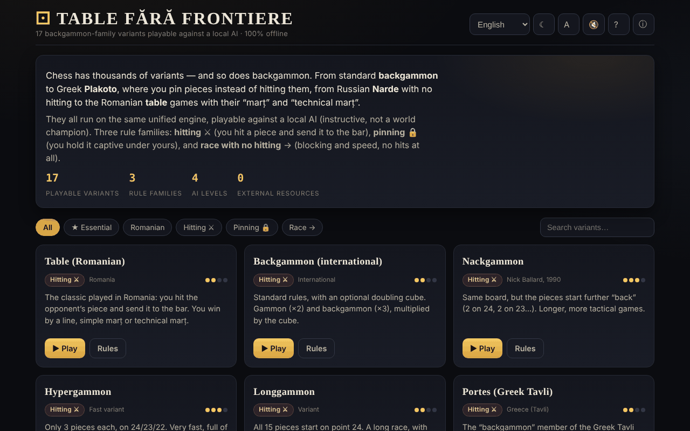

# Table fără frontiere

**English** · [Română](README.ro.md) · [Français](README.fr.md) · [Italiano](README.it.md) · [Español](README.es.md) · [Português](README.pt.md) · [Deutsch](README.de.md) · [Magyar](README.hu.md)

**Version:** 1.2.2 · **Last updated:** 2026-10-22

Interface languages: **Română, English, Français, Italiano, Español, Português (PT), Deutsch, Magyar**

17 backgammon-family variants playable against a local AI, in a single HTML file.

**Live:** https://chiuta.github.io/Table-fara-frontiere/

## What it is

A playable atlas of the "tables" family of games: Western backgammon, Greek Tavli (Portes, Plakoto, Fevga), Turkish Tavla, Bulgarian Tapa, Russian Narde, Gul Bara, and Romanian variants with marț and technical marț. They all run on the same game engine, with three families of rules: with hitting ⚔, with pinning 🔒 and a race without hitting →. The opponent is a local AI with an educational role, not a tournament engine.

## Features

- 17 variants, including: Table (Romanian), Backgammon (international), Nackgammon, Hypergammon, Longgammon, Portes, Tavla, Acey-Deucey, Russian Backgammon, Plakoto, Tapa, Moultezim / Mahbusa, Fevga, Narde / Long Table, Gul Bara, Table pe duse (Romanian, long), Table de pierdut (Misère).
- Atlas filters: All, ★ Essentials, Romanian, With hitting, With pinning, Race.
- AI with four levels: Beginner, Medium, Advanced, Expert (evaluation function, plus a 1-ply expectimax search at the higher levels, according to the description in the app).
- Doubling cube (optional, with the AI proposing doubles), score per game, marț calculation for the Romanian variants.
- **In-game guidance:** a line of hints under "Your turn" says what comes next (roll, pick the checker, pick the point, end the turn). **⌨ Possible moves** (drop-down list) shows the legal moves as buttons ("Die 2: from 13 → 11 · hits"), so the board can also be played with the keyboard or a screen reader.
- Buttons: **Roll the dice**, **↶ Back**, **Hint**, **✓ End turn**, **New game**, **Rules**.
- Theme (☾; on first opening it follows the system preference), text size (A), sound (🔇), help (?) and "About this atlas" (ⓘ).
- Rule approximations are marked on the variant's card with "⚠ approximation".

## User guide

1. Choose a variant from the atlas (or filter by family) and press **▶ Play this variant**.
2. You play the white checkers (●), the AI the black ones (○). Press **Roll the dice**; on doubles you have four moves.
3. Tap one of your own checkers, then the highlighted target point; to bear off a checker, tap the "Borne off" area.
4. **↶ Back** undoes the last move of the turn; **✓ End turn** ends the turn.
5. From "Settings" you choose the AI level and, if you want, the doubling cube.
6. Keyboard shortcuts: **R** rolls the dice, **U** back, **Enter** ends the turn, **H** hint, **N** new game, **T** theme, **A** text, **Esc** back / close.
7. **← Atlas** takes you back to the list of variants.

## Privacy and network

- **Local storage (localStorage):** a single key, `tff`, with your preferences: theme, text size, sound, AI level, the doubling cube option and the display of point numbers.
- **Network:** the app makes no network requests and loads no external resources. The Buy Me a Coffee links open only on click. No telemetry.

## Running locally / offline

Download `index.html` and open it in a browser; it works without internet.

## License

MIT — see the `LICENSE` file. The header of `index.html` and the interface text state the same license (an earlier "CC-BY-SA 4.0" mention in the interface was removed during the audit, 2026-10-11, to remove the contradiction).

## Trademarks

Game names are trade names of their holders, used descriptively; the project is not affiliated with them.

## Audit

Audit: 2026-10-10 — checked with Playwright and axe-core (WCAG 2.1 AA, both themes); checked in code: no `fetch`/CDN, strict CSP (`default-src 'self'`, script by hash since round 6). Fixed: contrast on the active filter in the light theme, focusable decorative checkbox.

## History / Changelog

- 1.2.2 — 2026-10-22: fff-kit 1.1.2: PBKDF2 600,000 iterations, anti-clickjacking protection
- 1.2.1 — 2026-10-22: Mobile legibility (text ≥ 12 px, larger footer links) and a note in the footer that the dice use Web Crypto (crypto.getRandomValues).

- 1.1.0 — 2026-10-14: Backup and data labelling (fff-kit).

- 1.0.0 — 2026-10-12: the version and the date of the last update are shown in the app (first numbered version; in the footer).

Round 7:
- **Point numbers on the board:** the 24 points are numbered on the edge of the board, with the same numbers as in the "⌨ Possible moves" list ("Die 6: from 13 → 7") — previously the list used numbers that appeared nowhere on the board. They can be hidden from "Settings → Point numbers" (the preference is kept in the `tff` key). CSP hash recalculated; axe-core = 0 violations at 1280 and 360 px.

Round 6:
- **Fix:** when you started after the opening die roll, the board stayed blocked (the highlights did not appear and clicks were ignored); now you can move immediately.
- In-game guidance (hint line) and "⌨ Possible moves" list for keyboard/screen readers.
- The initial theme follows `prefers-color-scheme`; contrast fixed on the active "AI level" button in the light theme; the "Settings" / "Rules in brief" headings are h3 (correct order).
- CSP: the script is now allowed by hash, without `'unsafe-inline'` for scripts (the app has no inline handlers). axe-core = 0 violations at 1280 and 360 px, in both themes, including in-game.

Round 5:
- After rolling the dice, the main button no longer keeps the text "Roll the dice": it shows "Dice rolled" (or "AI's turn") while disabled; it goes back to "Roll the dice" on your turn.
- Accessibility: the atlas card titles are h2 (correct order under h1), the support block is a `complementary` landmark; axe-core = 0 violations at 1280 and 360 px.

## Author

Alexio — Alexandru-Ionuț Chiuță, Centrul StrING (as mentioned in the app). Contact: alexio@trom.tf

## English summary

Table fără frontiere is a single-file atlas of 17 backgammon-family games (Western backgammon, Greek Tavli, Turkish Tavla, Narde, Romanian table variants and more) playable against a local, educational AI with four difficulty levels, on one unified rules engine. Keyboard shortcuts are provided; only preferences are stored in localStorage and no network requests are made. UI in Romanian. Licensed MIT (see LICENSE).
