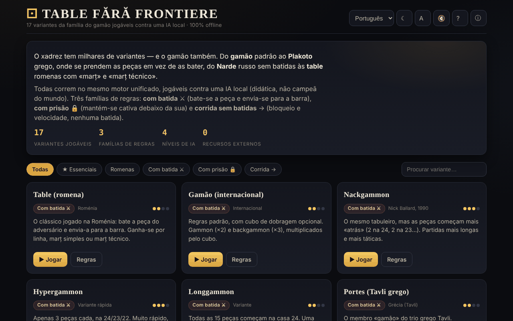

# Table fără frontiere

[English](README.md) · [Română](README.ro.md) · [Français](README.fr.md) · [Italiano](README.it.md) · [Español](README.es.md) · **Português** · [Deutsch](README.de.md) · [Magyar](README.hu.md)

**Versão:** 1.2.0 · **Última atualização:** 2026-10-19

Idiomas da interface: **Română, English, Français, Italiano, Español, Português (PT), Deutsch, Magyar**

17 variantes da família do gamão jogáveis contra uma IA local, num único ficheiro HTML.

**Online:** https://chiuta.github.io/Table-fara-frontiere/

## O que é

Um atlas jogável da família dos jogos de «tabuleiro» (tábuas): gamão ocidental, Tavli grego (Portes, Plakoto, Fevga), Tavla turca, Tapa búlgara, Narde russo, Gul Bara e variantes romenas com marț e marț técnico. Todas correm no mesmo motor de jogo, com três famílias de regras: com captura ⚔, com bloqueio 🔒 e corrida sem captura →. O adversário é uma IA local com função didática, não um motor de torneio.

## Funcionalidades

- 17 variantes, entre as quais: Table (romeno), Backgammon (internacional), Nackgammon, Hypergammon, Longgammon, Portes, Tavla, Acey-Deucey, Gamão russo, Plakoto, Tapa, Moultezim / Mahbusa, Fevga, Narde / Tábuas longas, Gul Bara, Table pe duse (romenas, longas), Table de pierdut (Misère).
- Filtros do atlas: Todas, ★ Essenciais, Romenas, Com captura, Com bloqueio, Corrida.
- IA com quatro níveis: Principiante, Médio, Avançado, Perito (função de avaliação, mais uma pesquisa expectimax de 1 ply nos níveis superiores, segundo a descrição na aplicação).
- Dado de dobragem (opcional, com proposta de dobragem por parte da IA), pontuação por partida, cálculo do marț para as variantes romenas.
- **Orientação durante o jogo:** uma linha de indicações por baixo de «A tua vez» diz o que se segue (lançar, escolher a peça, escolher a casa, terminar a vez). **⌨ Jogadas possíveis** (lista pendente) mostra as jogadas legais como botões («Dado 2: de 13 → 11 · captura»), pelo que o tabuleiro também se pode jogar com o teclado ou com um leitor de ecrã.
- Botões: **Lançar os dados**, **↶ Voltar**, **Sugestão**, **✓ Terminar a vez**, **Novo jogo**, **Regras**.
- Tema (☾; na primeira abertura segue a preferência do sistema), tamanho do texto (A), som (🔇), ajuda (?) e «Acerca deste atlas» (ⓘ).
- As aproximações das regras são assinaladas no cartão da variante com «⚠ aproximação».

## Manual de utilização

1. Escolha uma variante no atlas (ou filtre por família) e prima **▶ Jogar esta variante**.
2. Você joga com as peças brancas (●), a IA com as pretas (○). Prima **Lançar os dados**; com uma dobra tem quatro jogadas.
3. Toque numa peça sua e depois na casa de destino realçada; para retirar uma peça, toque na zona «Retiradas».
4. **↶ Voltar** anula a última jogada da vez; **✓ Terminar a vez** conclui a vez.
5. Em «Definições» escolhe o nível da IA e, se quiser, o dado de dobragem.
6. Atalhos de teclado: **R** lança os dados, **U** volta, **Enter** termina a vez, **H** sugestão, **N** novo jogo, **T** tema, **A** texto, **Esc** voltar / fechar.
7. **← Atlas** leva-o de volta à lista de variantes.

## Privacidade e rede

- **Armazenamento local (localStorage):** uma única chave, `tff`, com as suas preferências: tema, tamanho do texto, som, nível da IA, opção do dado de dobragem e apresentação dos números das casas.
- **Rede:** a aplicação não faz pedidos de rede e não carrega recursos externos. As ligações Buy Me a Coffee só se abrem ao clicar. Sem telemetria.

## Execução local / offline

Descarregue `index.html` e abra-o num navegador; funciona sem Internet.

## Licença

MIT — veja o ficheiro `LICENSE`. O cabeçalho de `index.html` e o texto da interface indicam a mesma licença (uma menção anterior a «CC-BY-SA 4.0» na interface foi removida na auditoria, 2026-10-11, para eliminar a contradição).

## Marcas

Os nomes dos jogos são designações comerciais dos seus titulares, usadas de forma descritiva; o projeto não é afiliado a estes.

## Auditoria

Auditoria: 2026-10-10 — verificado com Playwright e axe-core (WCAG 2.1 AA, ambos os temas); verificado no código: sem `fetch`/CDN, CSP estrita (`default-src 'self'`, script por hash desde a ronda 6). Corrigidos: contraste no filtro ativo do tema claro, caixa de seleção decorativa que podia receber o foco.

## Histórico / Changelog

- 1.1.0 — 2026-10-14: Cópia de segurança e etiquetagem de dados (fff-kit).

- 1.0.0 — 2026-10-12: a versão e a data da última atualização são apresentadas na aplicação (primeira versão numerada; no rodapé).

Ronda 7:
- **Números das casas no tabuleiro:** as 24 casas estão numeradas na margem do tabuleiro, com os mesmos números da lista «⌨ Jogadas possíveis» («Dado 6: de 13 → 7») — antes, a lista usava números que não apareciam em lado nenhum do tabuleiro. Podem ser ocultados em «Definições → Números das casas» (a preferência fica guardada na chave `tff`). Hash CSP recalculado; axe-core = 0 violações a 1280 e 360 px.

Ronda 6:
- **Correção:** quando começava você após o dado de abertura, o tabuleiro ficava bloqueado (os realces não apareciam e os cliques eram ignorados); agora pode jogar de imediato.
- Orientação durante o jogo (linha de indicações) e lista «⌨ Jogadas possíveis» para teclado/leitores de ecrã.
- O tema inicial segue `prefers-color-scheme`; contraste corrigido no botão ativo «Nível da IA» no tema claro; os títulos «Definições» / «Regras em resumo» são h3 (ordem correta).
- CSP: o script é agora permitido por hash, sem `'unsafe-inline'` para scripts (a aplicação não tem handlers inline). axe-core = 0 violações a 1280 e 360 px, em ambos os temas, inclusive durante o jogo.

Ronda 5:
- Depois de lançar os dados, o botão principal já não mantém o texto «Lançar os dados»: mostra «Dados lançados» (ou «Vez da IA») enquanto está desativado; volta a «Lançar os dados» na sua vez.
- Acessibilidade: os títulos dos cartões do atlas são h2 (ordem correta sob h1), o bloco de apoio é um ponto de referência `complementary`; axe-core = 0 violações a 1280 e 360 px.

## Autor

Alexio — Alexandru-Ionuț Chiuță, Centrul StrING (conforme mencionado na aplicação). Contacto: alexio@trom.tf

## Resumo em inglês

Table fără frontiere é um atlas num único ficheiro de 17 jogos da família do gamão (gamão ocidental, Tavli grego, Tavla turca, Narde, variantes romenas de tábuas e outros) jogáveis contra uma IA local com função didática, com quatro níveis de dificuldade, num motor de regras unificado. Estão previstos atalhos de teclado; apenas as preferências são guardadas em localStorage e não é feito nenhum pedido de rede. Interface em romeno. Licença MIT (ver LICENSE).
